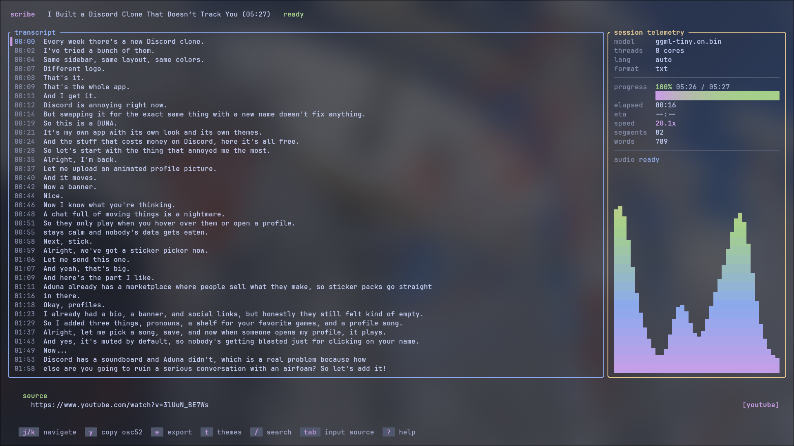

# scribe



<p align="center">
  
  
  
  
  
  <a href="https://crates.io/crates/scribe-tui"></a>
  <a href="https://aur.archlinux.org/packages/scribe-tui-bin"></a>
  
</p>

speech to text in the terminal. point it at a file or a url, get a timestamped
transcript while the audio is still playing, press `e` when you want it out.
runs locally on your cpu. no cloud, no account, no telemetry, no electron.

## install

the crates.io name is `scribe-tui` because somebody else got plain `scribe`
first. the binary is still `scribe`, which is the part you actually type.

```sh
cargo install scribe-tui
```

from a checkout:

```sh
cargo build --release
./target/release/scribe
```

prebuilt cpu binaries land on the releases page for linux, macos and windows
when we cut a tag.

## setup, or the lack of it

nothing to install by hand. on first url use, the `yt-dlp` crate fetches its own
yt-dlp and ffmpeg binaries into `~/.cache/scribe/bin/yt-dlp-2` (or under
`$XDG_CACHE_HOME`). local files use the ffmpeg on your `PATH`, falling back to
the managed copy if you have none.

models live in the platform cache (`~/.cache/scribe/models` on linux,
`~/Library/Caches/scribe/models` on macos, `%LOCALAPPDATA%\scribe\models` on
windows, or under `$XDG_CACHE_HOME`). press `m` in the tui to pick one and it
downloads itself from hugging face. start with `small-q5_1`. downloads are
checked against the upstream sha-256 before they are accepted; a bad file gets
deleted and retried. a per-model lock keeps two scribe processes from appending
to the same partial file.

every catalog model is verified against its catalog size and sha-256 before it
reaches whisper, whether it came from the picker, `--model`, a saved preference
or the default lookup. a corrupt cache file is rejected with instructions to
re-download it; a different intact cached model still works. custom ggml paths
are checked for a plausible size and ggml/gguf header, but there is no catalog
checksum to compare them against.

settings made in the tui persist in the platform config directory (for example
`~/.config/scribe/config` or `$XDG_CONFIG_HOME/scribe/config`). command-line
options win over saved values. `--help` and error output borrow their colors
from your saved theme when stdout is a terminal. `NO_COLOR` and `TERM=dumb` turn
that off.

run `scribe --doctor` for a read-only report on ffmpeg, yt-dlp, model integrity,
paths and permissions. it installs nothing and writes nothing.

## usage

```sh
scribe                            # just open it
scribe meeting.wav                # preload a file
scribe https://youtu.be/...       # preload a url
scribe a.wav --model base-q5_1    # pick a model by name
scribe a.wav --threads 4          # cap cpu threads
scribe a.wav --format srt         # export format
scribe a.wav --lang de            # language hint
scribe a.wav --translate          # translate to english
scribe a.wav --no-tui             # plain transcript to stdout, for scripts
scribe --doctor                   # read-only installation check
scribe --help
scribe --version
```

language codes are validated against whisper's own language table before
inference. `auto` lets the model detect the language; an english-only model
forces english regardless of the hint. the settings panel cycles through the
supported languages with human-readable names.

`--no-tui` writes the transcript to stdout and keeps whisper's chatter on
stderr, so `scribe audio.wav --no-tui > out.txt` does what you expect.

## keybinds

| key | action |
| --- | --- |
| enter | start, confirm, accept a completion, or resume when paused |
| tab | switch focus; fill the shared prefix or accept a path completion |
| up / down | move selection, or move through completion suggestions |
| right | accept the highlighted completion |
| ctrl+space | force the completion list open |
| esc / space / p | pause the active job; press again to resume (`space` works in the transcript pane) |
| c | stop the active job, keeping the segments already captured |
| / | live search |
| n / N | next / previous match |
| j / k | move selection |
| page up / page down | scroll ten rows |
| esc | dismiss completion, clear search, or go back |
| e | export menu |
| y | copy selected segment (osc 52, works over ssh) |
| m | model picker |
| s | settings |
| t | theme palette (live preview) |
| ? | help |
| ctrl+c | quit |

the first `esc` pauses an active transcription, not kills it. `enter`, `space`
or `p` picks it back up at the same audio position. nothing restarts from zero.
a second `esc`, or `c`, stops it for good and leaves the partial transcript in
place so you can still export it.

inside the **source field**, path completion behaves like you would expect from
an editor: fuzzy rank, inline ghost text, a suggestion list you can navigate,
shared-prefix fill on the first `tab`, and a full commit on the second.

inside the **model picker**:

| key | action |
| --- | --- |
| enter | activate a ready model, or start / resume a download |
| p | pause the active download (partial data is kept) |
| c | cancel the active download and delete its partial file |
| x | remove a cached model |
| j / k or up / down | move through the table |
| page up / page down | jump ten rows |
| home / end | jump to the first or last row |
| esc | pause a download, or close |

inside the **theme picker**, `j / k` or the arrow keys cycle with a live preview.
`enter` confirms; `esc` reverts the preview and closes.

## themes

22 palettes, switchable at runtime with `t`. the full set:

catppuccin mocha, catppuccin macchiato, catppuccin frappe, catppuccin latte,
tokyo night, tokyo night storm, nord, dracula, gruvbox dark, one dark,
solarized dark, solarized light, github dark, github light, everforest,
kanagawa, rose pine, rose pine dawn, material dark, palenight, cyberpunk,
high contrast.

`--theme <name>` sets the startup theme. aliases are accepted (`dark`, `light`,
`contrast`, `nord`, `tokyo-night`, `rose-pine-dawn`, and so on). unknown names
fall back to catppuccin mocha rather than making a scene.

## models

the picker carries all 33 pre-converted ggml models from the upstream
`ggerganov/whisper.cpp` repository, including quantized `q5`/`q8` builds and
english-only `.en` variants. the default is `small-q5_1`; `large-v3-turbo-q5_0`
is the quality pick. shas come from hugging face file metadata; the upstream
readme table is stale and we do not trust it.

| name | disk | approx ram | speed |
| --- | --- | --- | --- |
| tiny / tiny.en | 75 MiB | 120 MiB | fastest |
| tiny-q5_1 / tiny.en-q5_1 | 31 MiB | 120 MiB | fastest |
| tiny-q8_0 / tiny.en-q8_0 | 42 MiB | 200 MiB | fastest |
| base / base.en | 142 MiB | 500 MiB | fast |
| base-q5_1 / base.en-q5_1 | 57 MiB | 200 MiB | fast |
| base-q8_0 / base.en-q8_0 | 78 MiB | 200 MiB | fast |
| small / small.en | 466 MiB | 1200 MiB | balanced |
| small-q5_1 / small.en-q5_1 | 181 MiB | 500 MiB | balanced |
| small-q8_0 / small.en-q8_0 | 252 MiB | 650 MiB | balanced |
| medium / medium.en | 1.5 GiB | 3200 MiB | accurate |
| medium-q5_0 / medium.en-q5_0 | 514 MiB | 1200 MiB | accurate |
| medium-q8_0 / medium.en-q8_0 | 785 MiB | 1600 MiB | accurate |
| large-v1 / large-v2 / large-v3 | 2.9 GiB | 3200 MiB | slow |
| large-v2-q5_0 / large-v3-q5_0 | 1.1 GiB | 2100 MiB | slow |
| large-v2-q8_0 | 1.5 GiB | 3200 MiB | slow |
| large-v3-turbo | 1.5 GiB | 3200 MiB | accurate |
| large-v3-turbo-q5_0 | 547 MiB | 1200 MiB | accurate |
| large-v3-turbo-q8_0 | 834 MiB | 1600 MiB | accurate |

sizes are from the upstream table. a quantized model is smaller and usually
quicker on cpu. "usually" is doing real work there; hardware differs, so
benchmark on your own box before calling anything the fastest. the picker shows
a ready/get badge and the first 12 characters of each sha.

custom ggml files work through `--model <path>` but do not show up in the picker.

## export

`txt`, `srt`, `vtt`, `md`, `json`. files go next to the source, or into `--out`.
existing files are not overwritten: the write uses exclusive creation, so two
processes racing on the same name cannot clobber one another, and a failed write
removes its own partial output.

word timings come from whisper's token data. in `srt` and `vtt`, segments with
word timings produce one cue per word (no overlapping segment cue); segments
without word timings produce a single segment cue. cues are sorted, clamped so
they never overlap, and sanitized to one line. `json` gets a `words` array per
segment, and markdown turns each word into a clickable timestamp link when the
source is a youtube url.

## performance notes

- cpu only. no cuda, metal, vulkan, hipblas, coreml or sycl code is compiled in.
- threads default to `min(logical cores, 8)`. `--threads` or the settings panel
  can override that.
- ffmpeg decodes incrementally and whisper runs 30-second windows with overlap
  handling, so words land while the tape is still rolling. stderr is drained on
  its own thread with a bounded tail, so a noisy decoder cannot deadlock the
  reader or flood the screen. the decoder's exit status is checked: partial pcm
  from a failed decode is never reported as a successful transcript.
- each job has a unique id carried on every worker event. events from a stopped
  job are dropped, so old segments or a stale "done" cannot land in a new
  transcript. workers are joined on shutdown.
- wrapped transcript lines are cached until segments or terminal width change,
  and search tests only new segments while the query is unchanged. static
  overlays no longer force redraws every frame.
- completion, scroll and status transitions are eased over a few frames; the ui
  goes quiet when nothing moves.
- if the text comes out nonsense, it is probably the model, not the pipeline.
  try turbo before filing an accuracy bug.

## the screen

wide terminals get the transcript plus a side panel for session info, progress
and a level meter. medium ones stack a compact status row under the transcript.
narrow ones drop the side panel entirely. the layout does not try to squeeze a
30-column pane into a 24-column terminal and call that responsive. below 20
columns you get a short message asking for more room, which is the honest
outcome.

the ui reads its colors from the selected palette, keeps the canvas transparent
so terminal blur shows through, and respects `NO_COLOR`, 16-colour ansi and
truecolor detection. pasting via bracketed paste never fires stray shortcuts.
toasts sit in the bottom-right corner and fade on their own; they carry
download and pause news without interrupting the transcript.

## versions

checked against crates.io and docs.rs, pinned in `Cargo.toml`.

| crate | version | note |
| --- | --- | --- |
| rust | stable, edition 2024 | msrv 1.90 |
| ratatui | 0.30.2 | crossterm 0.29 re-export |
| crossterm | 0.29.0 | same major, no version skew |
| whisper-rs | 0.16.0 | cpu-only, all gpu features off |
| yt-dlp | 2.10.0 | cache-json + rustls features |
| tokio | 1.54.1 | current-thread runtime for url fetch only |
| ureq | 3.5.2 | model downloads |
| sha2 | 0.11.1 | model checksum verification |
| unicode-width | 0.2.3 | wrapping that does not cut wide glyphs |
| which | 8 | find system ffprobe |

two quirks worth knowing: yt-dlp 2.10.0 needs a cache feature just to compile,
and whisper-rs 0.16's abort callback is unreliable mid-encode. both are worked
around in code. if you touch those lines, leave the comments alone.

## limits, honestly

- some sites want cookies or a specific player client. yt-dlp covers 1800+, but
  authentication stays a site-by-site problem.
- word timings follow whisper token boundaries, not forced alignment. a token
  can cover several words in some languages.
- custom ggml models work through `--model` but are not in the picker.
- pausing a transcription parks inference between decode windows, not in the
  middle of one. a fetch or decode step that is already running finishes, and
  the ui says so. the ui ignores late events and resumes at the last committed
  position.
- stdin piping and batch transcription are deliberately not implemented in
  0.3.0. neither fits the current single-job lifecycle well enough to ship
  reliably.
- model downloads need network access once. url transcription needs network
  access every time. audio decoding and inference are local and offline.
- release artifacts are built by ci on linux x86_64, macos aarch64 and windows
  x86_64. other targets are not tested.

## building from source

whisper-rs compiles whisper.cpp through bindings, so a c/c++ toolchain and
cmake are needed. on debian/ubuntu:

```sh
sudo apt-get install clang libclang-dev cmake pkg-config
```

macos needs xcode command line tools and cmake; windows needs the msvc build
tools and cmake. the cpu-only build has no cuda/metal/vulkan backend to link.
at runtime, local files need ffmpeg, and url input additionally uses yt-dlp,
which scribe fetches on first use if no managed copy exists.

## build, test, run

```sh
cargo build --release
cargo test
cargo clippy --all-targets -- -D warnings
cargo fmt --all -- --check
cargo publish --dry-run --allow-dirty   # packaging check, nothing is uploaded
./target/release/scribe
```

## license

mit
